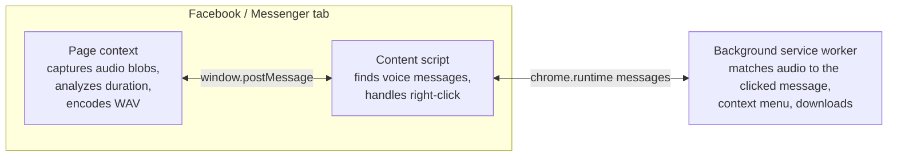

<p align="center">
  
</p>

<h1 align="center">VoiLoad</h1>

<p align="center">
  <strong>Download Facebook Messenger voice messages with one right-click.</strong><br>
  14,000+ users · 4.6★ on the Chrome Web Store · built and maintained solo
</p>

<p align="center">
  <a href="https://chromewebstore.google.com/detail/mdfkgjchjahncgcfnakojklkphfchohe"><strong>Install from the Chrome Web Store →</strong></a>
</p>

<p align="center">
  <a href="https://github.com/richardlinio/voiload/actions/workflows/ci.yml"></a>
</p>

---

## Why it exists

People send voice messages they want to keep: a parent's voice, a client's instructions, a memory. Facebook and Messenger give you no way to save one. Other tools I found were unreliable, required opening developer tools, or charged money.

VoiLoad turns it into one step. Right-click the voice message, choose **Download Voice Message**, and the file is saved.

## Traction

| Metric | Value |
| --- | --- |
| Users | **14,000+** (Chrome Web Store, October 2026) |
| Rating | **4.6★** |
| Time to launch | First commit March 19, 2025; on the Chrome Web Store the same month |
| Team | One person: product, design, engineering and support |

I started teaching myself to code in 2024 with Harvard's CS50. I shipped VoiLoad in March 2025 and still maintain it.

## Product decisions

Each decision removes a step or a point of failure for the user.

- **No new UI to learn.** The download lives in the right-click menu, next to the message you want. Onboarding is a three-step guide with a short tutorial video.
- **It downloads the message you clicked.** A chat can hold dozens of voice messages. VoiLoad matches the one under your cursor by its duration, not by its position on the page.
- **It recovers instead of failing.** When VoiLoad cannot be sure which recording you clicked, it offers **Download All** instead of showing an error.
- **The file plays everywhere.** Facebook serves voice as Opus/Ogg, which many players can't open. VoiLoad converts it to WAV in the browser. It names a file `.wav` only after the conversion succeeds, so you never get a mislabeled file. Each file name gets a timestamp and a unique ID, so batch downloads never overwrite each other.
- **It doesn't depend on Facebook's display language.** VoiLoad finds voice messages by page structure, not by translated labels. A regression matrix covers 18 localized labels, unknown labels, and look-alikes such as video scrubbers.
- **Your messages stay on your device.** Voice messages never leave your browser. VoiLoad has no server and collects no usage data.

## Staying reliable on a moving target

Facebook changes its page structure without notice, and any change can break a tool like this. Much of the engineering goes into catching those breaks before users do.

| Layer | What it checks |
| --- | --- |
| **615 unit tests** (Jest, 27 suites) | Detection, audio capture, matching, WAV encoding, file naming, download flow |
| **29 end-to-end tests** (Playwright) | Loads the built extension against de-identified Facebook page fixtures and real audio files. Covers the language matrix and regressions from user bug reports, such as a 61-second message and two messages of the same length. |
| **Live smoke test** | Runs locally against a real, signed-in Facebook chat. It confirms detection, audio capture, an exact match (not the fallback), WAV validity and duration. It never exports cookies and records no screenshots, traces or video. Its report holds only counts, labels, durations and WAV headers. Release policy: run it before each release, monthly between releases, and whenever a user reports a failed download. |
| **CI** (GitHub Actions) | Unit tests, type check, lint and production build on every push and pull request, plus the Playwright suite |

When Facebook changes its page structure, the fix follows a written protocol. Capture a minimal, de-identified page fragment. Add it as a fixture and confirm the tests fail. Fix the code until the tests pass, then confirm on the live site.

## How it works

VoiLoad is a Manifest V3 Chrome extension written in TypeScript. It runs in three browser contexts:



- **Capturing audio.** The page-context script observes the audio blobs Facebook creates. The background worker observes audio requests to Meta's CDNs. Video blobs are rejected.
- **Surviving service worker restarts.** Chrome stops an idle MV3 service worker after about 30 seconds. Captured audio is written through to `chrome.storage.session`, so a restart loses nothing.
- **Quiet in production.** Every module has its own logger, and production builds log only warnings and errors.

Design and architecture notes live in [`docs/`](docs/), starting with [`architecture.md`](docs/architecture.md) and [`prd.md`](docs/prd.md). Some docs are written in Traditional Chinese.

## How I build

I build VoiLoad with an agentic coding workflow and write a spec before any code:

- **Spec first.** The first pull request set out the product requirements and the technical design. Larger changes start as a written plan with acceptance criteria. For example, [`docs/1.1.3-reliability-plan.md`](docs/1.1.3-reliability-plan.md) sets out a release gate.
- **Explicit rules for coding agents.** [`AGENTS.md`](AGENTS.md) records the architecture, the MV3 constraints that are easy to miss, and a verification contract. Every change must pass `pnpm check`. Changes to detection or downloads must also pass the end-to-end suite. Changes that depend on Facebook's page structure must pass the live smoke test.
- **Written reviews.** Before 1.0, I reviewed the whole v0.5.0 codebase in writing ([`docs/codereview-v0.5.0.md`](docs/codereview-v0.5.0.md)). The move to TypeScript and a unit-test suite followed.
- **Small, reviewable changes.** 57 merged pull requests since March 2025.

## Development

Requires Node 22.23.4 (see `.nvmrc`) and pnpm.

```bash
pnpm install
pnpm dev          # webpack watch build into dist/
pnpm build        # production build
pnpm check        # unit tests + type check + lint (the CI gate)
pnpm test:e2e     # build, then run the Playwright suite
pnpm package      # zip dist/ for Chrome Web Store upload
```

To try a local build, open `chrome://extensions`, turn on **Developer mode**, click **Load unpacked**, and select `dist/`.

## About

Built by **Richard Lin**, Co-founder & CPO at AllWill. Before software, I spent 10+ years designing launch and keynote presentations for clients including Nike, Google and BMW. As a co-founder, I also turned around a medical aesthetics business.

[richardlin.io](https://richardlin.io/) · [LinkedIn](https://www.linkedin.com/in/richardlinio/) · [X](https://x.com/richardlin_io)

---

<sub>VoiLoad is an independent project. It is not affiliated with, endorsed by, or sponsored by Meta Platforms, Inc. Facebook and Messenger are trademarks of Meta Platforms, Inc.</sub>
